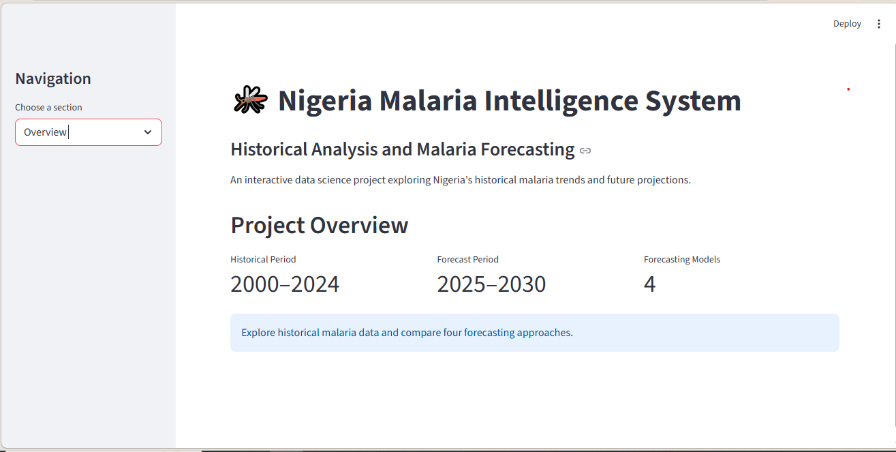

Nigeria Malaria Intelligence System 🦟

Project Overview

The Nigeria Malaria Intelligence System is a data science project designed to analyse historical malaria incidence data in Nigeria and forecast possible future trends using statistical and machine learning techniques.

The project demonstrates how data science can support public health research and decision-making.

Project Objectives
	•	Analyse malaria incidence trends in Nigeria.
	•	Explore historical malaria data from 2000 to 2024.
	•	Develop and compare forecasting models.
	•	Forecast possible trends from 2025 to 2030.
	•	Communicate findings through an interactive dashboard.

Data Source
	•	Source: World Health Organization (WHO).
	•	Database: Global Health Observatory (GHO).
	•	Country: Nigeria.
	•	Indicator: MALARIA_EST_INCIDENCE.
	•	Period: 2000–2024.
	•	Observations: 25 annual records.

Technologies
	•	Python
	•	Pandas
	•	NumPy
	•	Matplotlib
	•	Scikit-learn
	•	Statsmodels
	•	Streamlit
	•	JupyterLab

Methodology
	1.	Data collection.
	2.	Data cleaning and preprocessing.
	3.	Exploratory Data Analysis (EDA).
	4.	Historical trend analysis.
	5.	Forecast model development.
	6.	Model evaluation.
	7.	Future forecasting.
	8.	Dashboard development.

Forecasting Models

Four forecasting models were developed:
	1.	Naive Forecast
	2.	Simple Exponential Smoothing
	3.	Holt’s Linear Trend
	4.	Linear Regression

Model Evaluation

Evaluation period: 2020–2024.

Model	MAE	RMSE
Holt’s Linear Trend	4.43	5.80
Naive Forecast	6.18	6.96
Simple Exponential Smoothing	6.18	6.96
Linear Regression	43.66	44.35

Lower MAE and RMSE values indicate better forecasting performance.

Dashboard Features

The Streamlit dashboard includes:
	1.	Overview
	2.	Historical Analysis
	3.	Forecasting
	4.	Model Evaluation
	5.	Insights

Project Structure

Nigeria_Malaria_Intelligence_System/
├── app/
│   └── app.py
├── data/
│   ├── raw/
│   └── processed/
├── models/
├── notebooks/
├── reports/
├── visualizations/
└── README.md

Limitations
	•	The dataset contains only 25 annual observations.
	•	Annual data cannot capture seasonal malaria patterns.
	•	The models do not incorporate rainfall, temperature or intervention coverage.
	•	Forecasts are estimates, not guaranteed future outcomes.
	•	The results should not replace official public health surveillance.

Future Improvements
	•	Integrate weather and climate data.
	•	Explore additional machine learning models.
	•	Include other public health indicators.
	•	Improve forecasting validation.
	•	Deploy the dashboard online.

Conclusion

This project demonstrates the application of data science, statistical analysis and forecasting to a real-world public health problem in Nigeria.

Domain: Data Science | Public Health Analytics | Predictive Modelling

Data Source: World Health Organization (WHO).
## Dashboard Preview

